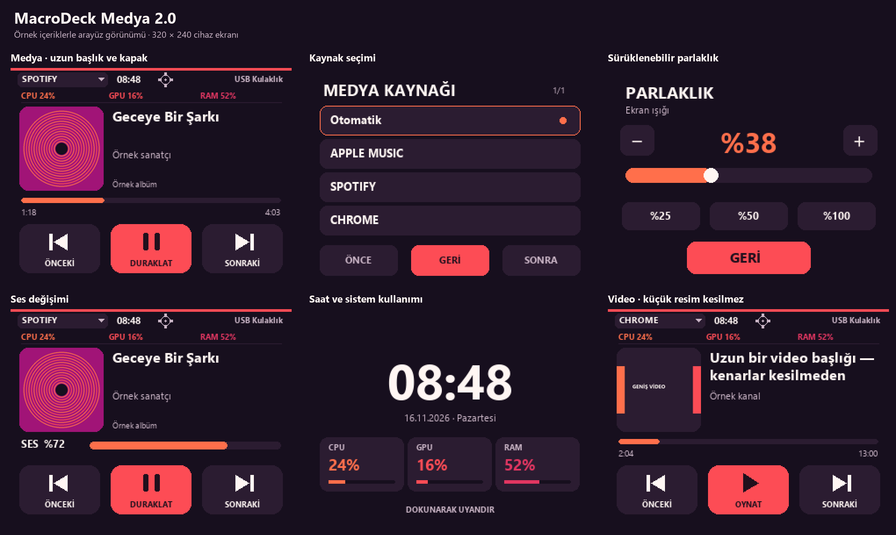

# MacroDeck Media

[](https://github.com/mahmutalpcetin/macrodeck-media/actions/workflows/checks.yml)

A DIY touchscreen media controller built with an **ESP32-S3**, a **2.8-inch ILI9341 display**, and a **rotary encoder**. A Windows companion app provides media artwork, playback controls, system volume, and a small system monitor.

**Status: working prototype.** Windows + wired USB is the supported setup. Wi-Fi, Bluetooth transport, battery operation, and the six-key macro pad are future work.

[Türkçe kullanım](docs/USAGE.tr.md) · [Wiring](docs/HARDWARE.md) · [Architecture](docs/ARCHITECTURE.md) · [Validation](docs/VALIDATION.md)



*Interface examples use demo media. The desktop UI and on-device text are currently in Turkish.*

## What works

- Apple Music, Spotify, and browsers that publish media information through Windows GSMTC.
- Artwork, title, artist, timeline, previous / play-pause / next touch controls.
- Automatic media selection or a pinned source, selectable on the device.
- Rotary volume control: fine 1% steps and acceleration up to 9% per step.
- Encoder clicks: single = play/pause; double = next; triple = previous; hold = system mute.
- Draggable brightness, presets, saved brightness, and a configurable dimmed clock screen.
- CPU/RAM usage and NVIDIA GPU usage when available.
- Audio output-device name; application-session matching with an explicit default-device fallback in the desktop UI.
- Windows notification-area icon: hide, restore, and exit without keeping a taskbar window open.
- Dirty-region updates, lossless RLE565 transport, CRC validation, and reconnect recovery.

## Hardware

Tested with a YD ESP32-S3 board using an ESP32-S3-WROOM-1 **N16R8**, a KMRTM28028-SPI **320×240 ILI9341 + HR2046/XPT2046** resistive touchscreen, and an HW-040 encoder. This is an assembled breadboard prototype, not a custom PCB or a finished enclosure.

See [the complete pin table](docs/HARDWARE.md) before connecting anything. In this build **GPIO18 controls the backlight through a 4.7 kΩ resistor; LCD MISO is disconnected**. Other display boards may have different backlight circuits.

## Windows setup

Requirements: **64-bit Windows 10/11**, **Python 3.12**, a data-capable USB cable, and the board's USB-UART driver if Windows does not already recognize it. The companion app needs to stay running for media/artwork and the current COM-based controls. No Apple Music or Spotify account credentials/API keys are required.

Download this repository and open PowerShell in its folder:

```powershell
py -3.12 -m venv .venv
.\.venv\Scripts\python.exe -m pip install -r desktop/requirements.txt
.\.venv\Scripts\python.exe desktop/app.py
```

After setup, `MacroDeck-Medya.bat` launches without a console window.

### First connection

1. Flash the matching display firmware if it is not already installed.
2. Connect the board's **COM / USB-UART** socket.
3. In **Bağlantı** (Connection), select the port and click **Bağlan** (Connect).
4. A validated device's USB identity is remembered locally for future automatic reconnects. The app does not probe arbitrary serial devices. Ports without a unique USB serial number must be selected manually after restarting the app.
5. Use **Dokunmatiği ayarla** for the four-point touchscreen calibration.

Close/minimize hides the app to the notification area. Double-click its icon to restore it; right-click → **Çıkış** to exit. Launching it again restores the existing window. **Windows açılınca başlat** optionally starts it hidden at login; it is not enabled automatically.

## Build and upload firmware

The board profile assumes **16 MB flash and 8 MB OPI PSRAM**. Review it before using a different ESP32-S3 variant. The `display` environment is the default; `headless` is a diagnostic build without LCD output.

```powershell
.\.venv\Scripts\python.exe -m pip install platformio==6.2.0
.\.venv\Scripts\python.exe -m platformio run --project-dir firmware -e display
```

Exit the companion app from its tray menu before uploading. Replace `COM_PORT` with your board's port:

```powershell
.\.venv\Scripts\python.exe flash.py --port COM_PORT --build display
```

`flash.py` delegates build/upload to PlatformIO. It does not use machine-specific package paths. Host and firmware communicate at **921600 baud**, protocol 3, with negotiated chunks up to 4096 bytes. Older 460800-baud firmware must be updated together with the app.

## Development

```powershell
.\.venv\Scripts\python.exe -m pip install -r requirements-dev.txt
.\.venv\Scripts\python.exe -m unittest discover -s desktop -p "test_*.py"
.\.venv\Scripts\python.exe ui_layout_check.py
```

The unit suite uses fake devices and mocked media/volume actions; it does not flash hardware or change the system volume. `tray_check.py` checks a temporary native tray/Tk window without starting the hardware worker. Hardware measurements are described separately in [Validation](docs/VALIDATION.md); CI is not a substitute for physical testing.

## Limitations and next steps

- Windows decides which media properties and controls an app exposes. Missing artwork, browser metadata, or unsupported skip actions cannot be supplied by this controller.
- Playlist names and the next queued track are not provided reliably by the current Windows integration.
- Audio-session matching can be ambiguous across multiple outputs. The UI reports multiple devices rather than choosing one. The encoder still controls the **system default output volume**, even when a media app uses another output.
- Six physical macro keys have firmware mappings but are not connected/tested on the current prototype. Native USB HID and Discord shortcuts/status are not established end-to-end features.
- Wi-Fi/Bluetooth connectivity, battery power, installer packaging, and an enclosure are not implemented.
- Currently tested on one physical setup; wider Windows/device compatibility needs community testing.

## Privacy and dependencies

Media is read locally through Windows APIs. Personal preferences, calibration, device identity, logs, virtual environments, generated binaries, and dependency copies are excluded from version control. Python dependencies are pinned in `desktop/requirements.txt`; firmware dependencies are declared in `firmware/platformio.ini` and retain their own licenses.

An explicit project license has not been selected yet.
