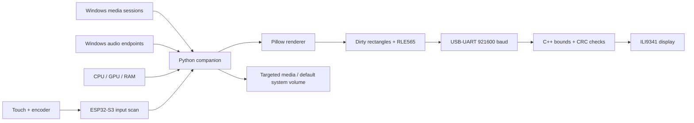

# Architecture

The Windows app renders 320×240 images. The ESP32-S3 validates image packets, updates the LCD, reads touch/encoder input, and controls PWM brightness.

Independent async tasks read media, system volume, audio output routes, and resource use. Serial transfer runs off the async event loop. A bounded input inbox coalesces intermediate drag positions; a latest-state mailbox avoids stale desktop preview queues. Media commands are serialized separately from encoder volume actions.

Physical inputs are bound to the last acknowledged LCD view/session. Navigation changes cannot reinterpret a tap on an old page as a button on a new page. Calibration has its own acknowledged-target state.

Image tokens are bounded to the decoded rectangle. Transport CRC and decoded pixel CRC are checked before painting. A failed frame does not become the dirty-diff baseline. A boot announcement clears cached images and input IDs. Only a previously approved matching project UART can use the DTR/RTS reset fallback after an interrupted binary transfer.

The host persists preferences atomically. Manual brightness is also stored on the MCU; temporary standby dimming does not overwrite it. The desktop app and native notification icon run separate message loops; callbacks return through a queue to the Tk thread.
